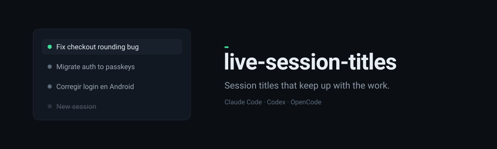

<p align="center">
  
</p>

<p align="center">
  <a href="https://www.npmjs.com/package/live-session-titles"></a>
  <a href="LICENSE"></a>
  
  
</p>

# live-session-titles

A skill for AI coding agents that renames the session you are in while you work. When you open the sidebar you see `Fix checkout rounding bug` and `Migrate auth to passkeys` instead of ten chats called `New session`.

It works with Claude Code (desktop and CLI), Codex and OpenCode, and it can clean up old sessions in bulk with a preview first and an undo afterwards. Cursor, Windsurf, Gemini CLI and Antigravity get a lighter version (see [Supported agents](#supported-agents)).

## What it does

- Sets a title when a task starts, updates it when the work changes stage, and fixes it once more at the end. It writes in the language of the conversation, so a chat in Spanish gets a Spanish title.
- Keeps titles to about 6 words. It goes a bit longer when 6 words cannot name the task, and never so long that it stops reading at a glance. `--max-words N` changes the limit.
- Adds a status suffix (`Audit payments: report ready`) only if you ask for it with `--status`.
- In the Claude desktop app, marks the session as completed when the task is done.
- `/retitle-all` goes through your old sessions in Claude, Codex and OpenCode (archived ones too, without unarchiving them), proposes titles and waits for your approval.
- `/retitle-sidebar` proposes names for the sections and groups in the Claude desktop sidebar, based on the sessions inside them.
- `/retitle-undo` puts back the titles from any earlier bulk run. The history has no size limit.
- A weekly check tells you when a new version is out. It fails silently when offline.

## Install

You need [Node.js 18 or newer](https://nodejs.org). The installer finds the agents you have and shows a checklist so you choose where it goes.

**Windows (PowerShell)**

```powershell
irm https://raw.githubusercontent.com/franco-valenzuela/live-session-titles/main/install.ps1 | iex
```

`irm | iex` cannot pass arguments, so flags go through an environment variable:

```powershell
$env:LST_ARGS = "--yes --agents claude,codex"; irm https://raw.githubusercontent.com/franco-valenzuela/live-session-titles/main/install.ps1 | iex
```

**macOS and Linux**

```bash
curl -fsSL https://raw.githubusercontent.com/franco-valenzuela/live-session-titles/main/install.sh | bash
```

With flags:

```bash
curl -fsSL https://raw.githubusercontent.com/franco-valenzuela/live-session-titles/main/install.sh | bash -s -- --yes --agents claude,opencode
```

**npm (any OS)**

The package is published under two names with the same content. Use either one:

```bash
npx live-session-titles install
npx @francovalenzuela/live-session-titles install
```

Or straight from GitHub, without npm's registry:

```bash
npx github:franco-valenzuela/live-session-titles install
```

### Installer flags

| Flag | Effect |
| --- | --- |
| `--yes` | Skip the checklist and install for every agent it detects |
| `--agents a,b` | Install only for these agents: `claude`, `codex`, `opencode`, `gemini`, `antigravity`, `windsurf`, `cursor` |

### Other ways to install

**skills.sh**

```bash
npx skills add franco-valenzuela/live-session-titles
```

This copies the skill only. You get live titles but not the slash commands, the hook or the global rule.

**Claude Code plugin**

```
/plugin marketplace add franco-valenzuela/live-session-titles
/plugin install live-session-titles@live-session-titles
```

The plugin brings the skill, the four commands and the SessionStart hook.

**By hand**

Download [`skills/live-session-titles/SKILL.md`](skills/live-session-titles/SKILL.md) and drop it in your agent's skills folder, for example `~/.claude/skills/live-session-titles/SKILL.md`. Copy the files in [`commands/`](commands) too if you want the slash commands.

## What the installer changes

For each agent you pick, it copies the skill and the commands, and adds a short rule to that agent's global instructions file. The rule sits between two markers:

```
<!-- live-session-titles:start -->
...
<!-- live-session-titles:end -->
```

Before it touches an existing file, it saves a backup next to it (`CLAUDE.md.lst-backup-2026-11-25`). Running the installer again replaces the block in place, so it never ends up duplicated.

For Claude Code it also adds a SessionStart hook to `~/.claude/settings.json`. The hook reminds the agent to keep the title current and prints the update notice when there is one.

It puts a `live-session-titles` launcher in `~/.local/bin` and tells you if that folder is missing from your PATH. Everything else lives in `~/.live-session-titles`.

## Supported agents

| Agent | Live rename | Bulk retitle | Where it installs |
| --- | --- | --- | --- |
| Claude Code (desktop) | Yes, native tools | Yes | `~/.claude/skills`, `~/.claude/commands`, `~/.claude/CLAUDE.md` |
| Claude Code (CLI) | Yes | Desktop sessions only | same as above |
| Codex | Yes, through `session_index.jsonl` | Yes | `~/.codex/skills`, `~/.codex/prompts`, `~/.codex/AGENTS.md` |
| OpenCode | Yes, through the `opencode` CLI | Yes | `~/.config/opencode/skills`, `.../commands`, `.../AGENTS.md` |
| Gemini CLI | Rule only | No | `~/.gemini/GEMINI.md` |
| Antigravity | Rule only | No | `~/.gemini/GEMINI.md` |
| Windsurf | Rule only | No | `~/.codeium/windsurf/memories/global_rules.md` |
| Cursor | Rule only, pasted by hand | No | Settings > Rules |

> **About the "rule only" agents.** Cursor, Windsurf, Gemini CLI and Antigravity do not let an agent rename its own chat. In those, the rule makes the agent start its replies with a `Session: <title>` line when the task changes, so you can see what the chat is about. The chat's real name in the app stays the same.

Codex renames work by appending a line to `~/.codex/session_index.jsonl`. The tool never edits or removes existing lines, and it backs the file up first. OpenCode needs its CLI on the PATH. If yours lives somewhere else, point `LST_OPENCODE_BIN` at it.

## Commands

| Command | What it does |
| --- | --- |
| `/title [text]` | Set the title to your text, or generate one from the conversation if you leave it empty |
| `/retitle-all` | Propose new titles for old sessions, show a table, apply after you approve |
| `/retitle-sidebar` | Propose names for sidebar sections and groups (Claude desktop) |
| `/retitle-undo` | Restore the titles from the last bulk run, or a specific one |

### `/retitle-all` flags

| Flag | Effect |
| --- | --- |
| `--force` | Propose a title for every session, not only the ones with bad or generic names |
| `--skip-running` | Leave sessions that are running right now alone (by default they are included) |
| `--lang xx` | Write every title in this language instead of each session's own |
| `--status` | Use the `Task: status` format |
| `--max-words N` | Change the word limit |
| `--agents claude,codex,opencode` | Limit the run to these sources |

The command reads each session with small, cheap subagents, then shows you the full list of changes. Nothing is renamed until you say so. If one session fails to load or rename, it is skipped and listed at the end.

### `/retitle-sidebar`

You pick "All" or a single section or group. For each one it either proposes a name or marks it "no change". Then you choose to apply everything, edit the proposals one by one, or cancel. It only touches sections you created by hand and groups; the app's built-in sections are left as they are.

### Undo

Every bulk run is saved as a JSON file in `~/.live-session-titles/history`. `/retitle-undo` restores the last one; `/retitle-undo --list` shows them all, and `/retitle-undo <run id>` restores a specific run.

## CLI

The skill calls these helpers, and you can use them too:

```
live-session-titles install [--yes] [--agents a,b]
live-session-titles uninstall [--purge]
live-session-titles update
live-session-titles status
live-session-titles check-update [--force]
live-session-titles codex-list [--json]
live-session-titles codex-rename <id>|--current "<title>"
live-session-titles opencode-list [--json]
live-session-titles opencode-rename <id> "<title>"
live-session-titles history list | last | show <id> | mark-undone <id>
```

`update` reinstalls the latest version from npm for the same agents you had.

## Update notices

Once a week the SessionStart hook asks the npm registry for the latest version, with a 2 second timeout. If there is a newer one, the agent sees a one-line notice with the command to update. To turn it off:

```bash
export LST_NO_UPDATE_CHECK=1          # macOS / Linux
```

```powershell
setx LST_NO_UPDATE_CHECK 1            # Windows
```

## Uninstall

```powershell
irm https://raw.githubusercontent.com/franco-valenzuela/live-session-titles/main/uninstall.ps1 | iex
```

```bash
curl -fsSL https://raw.githubusercontent.com/franco-valenzuela/live-session-titles/main/uninstall.sh | bash
```

Or `live-session-titles uninstall`. It removes the block between the markers and leaves the rest of your instructions file alone. It also removes the skill, the commands it installed, the hook and the launcher. Your rename history stays unless you add `--purge` (`$env:LST_ARGS = "--purge"` on Windows, `bash -s -- --purge` elsewhere).

## Contributing

Bug reports and pull requests are welcome. If you want support for another agent, open a [new agent request](https://github.com/franco-valenzuela/live-session-titles/issues/new?template=new_agent.md) with where it keeps its sessions and whether it has a way to rename them. See [CONTRIBUTING.md](CONTRIBUTING.md).

## License

[MIT](LICENSE)
